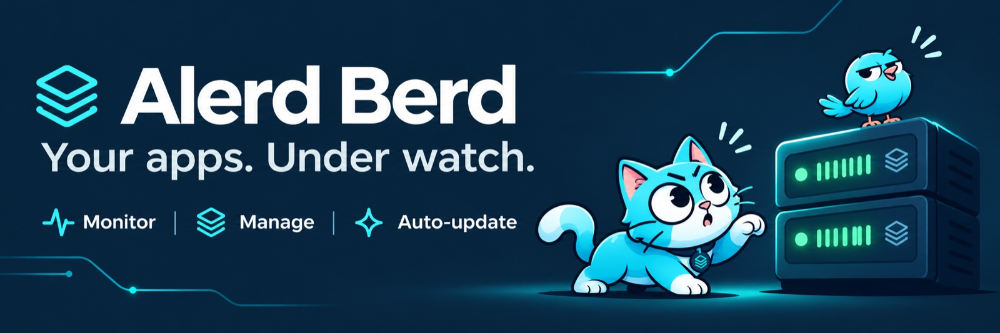
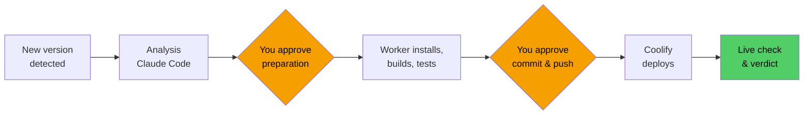
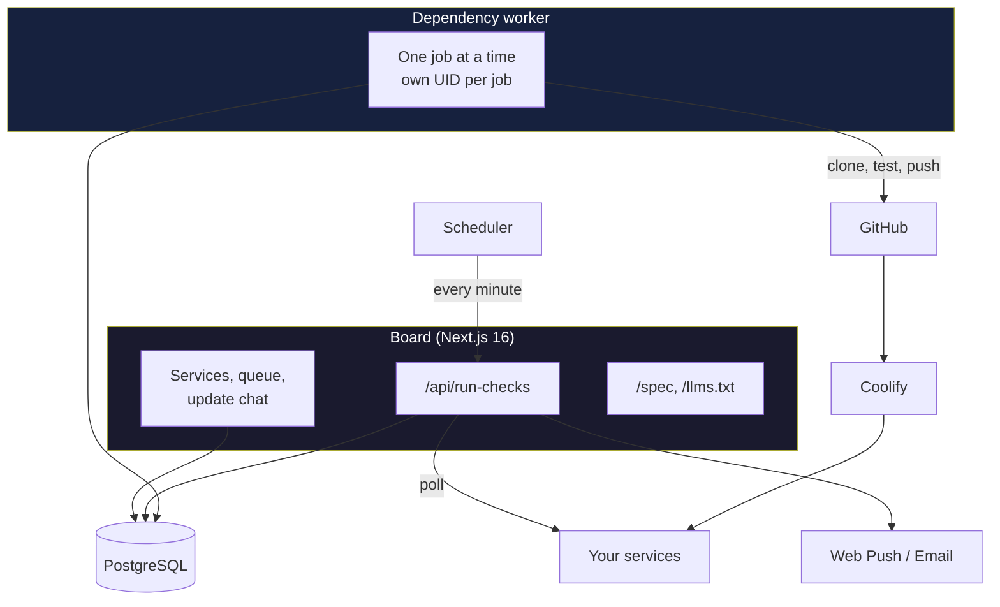

<p align="center">
  
</p>

<p align="center">
  <strong>Watches your services, wakes you when they fall over, and keeps their packages current.</strong><br>
  Self-hosted monitoring with a health contract, Web Push alerts and dependency updates you approve step by step.
</p>

<p align="center">
  <a href="https://github.com/Marvbuster/alerd-berd-public/actions/workflows/test.yml"></a>
  <a href="https://github.com/Marvbuster/alerd-berd-public/pkgs/container/alerd-berd-public"></a>
  <a href="LICENSE"></a>
  
  
</p>

Available in **English** and **German**, including mails, push and the update assistant. Each user picks a language in Settings, new instances default to English (`ALERD_DEFAULT_LOCALE=de` switches that).

---

## Built for Coolify

Alerd Berd is made for apps you deploy with [Coolify](https://coolify.io). Monitoring and alerts work for any URL, but the services view, version watch and dependency updates all start from your Coolify apps: Alerd reads the app list from the Coolify API, takes the GitHub repository and branch from each app, and lets Coolify do the deploy after a push.

| You have | You get |
|---|---|
| Just URLs to watch | Monitors, incidents, Web Push and email alerts, the health contract |
| + a Coolify instance with apps from GitHub | Services view, live versions, version watch, daily digest |
| + a GitHub token with push rights and Claude Code (or a local analysis node) | Dependency updates with analysis, tested diff and approval per step |

Without Coolify, Alerd Berd is a capable uptime monitor, and the update side stays empty.

## Why

Most uptime tools tell you a service is down. Alerd Berd also asks the service how it feels: your apps answer a small health contract with components, metrics and the package versions they actually run. From there it is a short step to the second job, keeping those packages current, with an AI assistant doing the reading and you doing the deciding.

## What it does

| | |
|---|---|
| **Monitoring** | Health contract, HTTP, keyword, TCP, ping and push monitors. Every check turns into a traffic light, and a service can only report itself worse, never better than it looks from outside. |
| **Incidents & alerts** | Outages become incidents. Alerts go out once per channel via **Web Push** (installable PWA, Android and iOS 16.4+) and **email** (Brevo or SMTP). |
| **Services view** *(Coolify)* | Monitors, live version, packages and updates of every app on one page, plus a 3D sphere if you like it fancy. |
| **Version watch** *(Coolify + GitHub)* | Reads `package.json` and the lockfile from GitHub, compares with what runs live and flags security fixes, recommended majors and known issues. |
| **Dependency updates** *(Coolify + GitHub + Claude Code)* | An update chat per service. Claude Code (or a local analysis node) reads release notes and your repo, a worker prepares and tests the change, and nothing is pushed until you approve it. |
| **Daily digest** *(Coolify)* | One morning mail with all pending updates, grouped across services. |
| **Coolify integration** | Imports your Coolify apps, watches deploys and checks that the pushed commit is really live. |

## The health contract

One route, one JSON object. `status` is the only required field:

```json
{ "status": "ok" }
```

Add components, metrics with thresholds and runtime versions when you want a richer picture:

```json
{
  "status": "degraded",
  "version": "1.4.2",
  "runtime": { "node": "24.11.0", "commit": "2970d7f", "packages": { "next": "16.4.6" } },
  "components": [
    { "name": "database", "status": "ok" },
    { "name": "smtp-relay", "status": "degraded", "detail": "delivery delayed" }
  ],
  "metrics": [
    { "name": "queue_depth", "value": 1200, "unit": "count", "warn": 1000, "crit": 5000 },
    { "name": "free_disk", "value": 42, "unit": "%", "warn": 15, "crit": 5, "direction": "below" }
  ]
}
```

Schema and guide: [`spec/alerd-health.schema.json`](spec/alerd-health.schema.json) and [`spec/implementing-health.md`](spec/implementing-health.md). An instance also serves them under `/spec/` and an LLM-friendly summary at `/llms.txt`, so a coding agent can implement the route in your app on its own.

## How an update flows



Each step needs its own approval. The worker shows the exact diff it tested, and the push only goes through if that diff is unchanged. After the deploy, Alerd Berd checks the running commit and versions through the health contract and writes a short verdict.

## Architecture



Board and worker run from the same image. The worker is optional; without it you get monitoring, alerts and version watch.

## Quick start

```bash
git clone https://github.com/Marvbuster/alerd-berd-public.git alerd && cd alerd
cp .env.example .env        # fill in the values below
docker compose --env-file .env -f deploy/docker-compose.yml up -d --build
```

Then point an HTTPS reverse proxy at `127.0.0.1:3000`, sign in with the admin account from `.env`, and schedule the check runner, for example every minute:

```bash
curl --fail -H "Authorization: Bearer $RUN_CHECKS_SECRET" "$ALERD_PUBLIC_URL/api/run-checks"
```

The web process does not poll on its own, so this call is what drives all checks. Migrations run automatically when the container starts.

**Required in `.env`:**

```bash
POSTGRES_PASSWORD=$(openssl rand -hex 24)
AUTH_SECRET=$(openssl rand -base64 48)
CREDENTIAL_ENCRYPTION_KEY=$(openssl rand -hex 32)   # keep it stable, back it up with the DB
RUN_CHECKS_SECRET=$(openssl rand -hex 24)
ADMIN_EMAIL=you@example.com
ADMIN_PASSWORD=...
ALERD_PUBLIC_URL=https://alerd.example.com
```

**With the dependency worker:** add `--profile worker` to the compose command. It runs as root inside its own container so it can give every job a separate UID. Don't mount the Docker socket or host folders into it, and read [SECURITY.md](SECURITY.md) first. Connect GitHub, Coolify and Claude Code in the settings.

Prefer a prebuilt image? Tagged releases are published to `ghcr.io/marvbuster/alerd-berd-public`.

<details>
<summary><strong>All environment variables</strong></summary>

| Variable | Purpose |
| --- | --- |
| `POSTGRES_PASSWORD` | Password of the Compose database. Use URL-safe characters. |
| `DATABASE_URL` | PostgreSQL connection; Compose sets it for you. |
| `AUTH_SECRET` | Session signing secret, at least 32 characters. Empty means development access, never leave it empty when hosting. |
| `ADMIN_EMAIL`, `ADMIN_PASSWORD` | Admin account, created at container start. |
| `ALERD_PUBLIC_URL` | External base URL for links in mails and invitations. |
| `ALERD_DEFAULT_LOCALE` | `en` by default; set `de` for a German instance. Used after browser preferences and as the background fallback when User.locale is unset. |
| `CREDENTIAL_ENCRYPTION_KEY` | 64-character hex key that encrypts integration credentials in the database. |
| `RUN_CHECKS_SECRET` | Bearer secret for the check runner. |
| `COOLIFY_ALLOWED_ORIGINS` | Comma-separated Coolify origins you allow, without paths. |
| `GITHUB_TOKEN` | Optional server token against GitHub API rate limits. Per-user credentials are stored encrypted. |
| `VAPID_PUBLIC_KEY`, `VAPID_PRIVATE_KEY`, `VAPID_SUBJECT` | Web Push keys, from `npx web-push generate-vapid-keys`. Board and worker both need them. |
| `BREVO_API_KEY`, `ALERT_FROM` | Preferred mail transport and sender. |
| `SMTP_HOST`, `SMTP_PORT`, `SMTP_USER`, `SMTP_PASSWORD` | SMTP fallback. Without either transport, mails are only logged. |
| `SPEC_ACCESS_TOKEN` | Optional legacy token for `/spec/*`; personal API keys or a session are preferred. |
| `SPEC_HEALTH_TOKEN` | Bearer token for this instance's own `/api/spec-health`; empty returns 503. |
| `DEPENDENCY_WORKER` | `1` switches the container to worker mode. Only on the worker. |
| `DEPENDENCY_WORKSPACE_ROOT` | Persistent worker workspace; Compose sets it. |
| `PORT`, `HOSTNAME` | Listener, defaults `3000` and `0.0.0.0`. |
| `SOURCE_COMMIT` | Optional build argument so the instance can report its running commit. |

`/api/health` is a plain liveness check without database access, use it for container health. The protected `/api/spec-health` is the deep check.

</details>

## Development

```bash
docker compose up -d                 # local PostgreSQL
cp .env.example .env
npm ci && npx prisma generate
npx prisma migrate deploy
npm run dev
```

Checks: `npx tsc --noEmit`, `npx vitest run`, `docker build .`. Schema changes go through `prisma migrate dev`.

## Tech stack

Next.js 16 (App Router) · React 19 · Prisma 6 · PostgreSQL 17 · Tailwind CSS 4 · Web Push (VAPID) · Vitest · Docker

## Security

The dependency worker runs foreign code (npm scripts, builds, an AI agent) on your server. [SECURITY.md](SECURITY.md) describes how it is isolated, where the limits are, and how to report a vulnerability privately.

## License

[Elastic License 2.0](LICENSE). You may self-host, study and modify it. Offering it to third parties as a hosted or managed service is not allowed.
